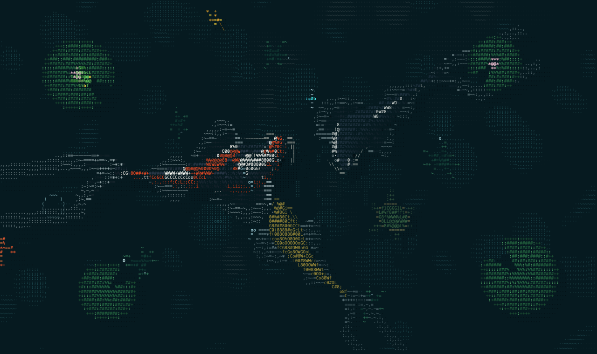

# ASCII Koi Pond — macOS Screen Saver

A native macOS Screen Saver (`.saver`) written in 100% Swift + CoreGraphics that turns your display into a living, top-down ASCII art Koi pond.



## Features

- **Procedural Top-Down Koi Fish**: 5 authentic Nishikigoi varieties (*Showa*, *Shiro Utsuri*, *Taisho Sanke*, *Yamabuki Ogon*, and *Kumonryu*) with overlapping diamond scales, gill seams, undulating dorsal fins, silk-lagged forked tails, and **physics-driven barbels** with water drag.
- **True Depth Illusion (Z-Axis)**: Swimmers dive and surface smoothly with water-absorption tinting, perspective scaling, Z-sorted overlap, and depth-proportional shadows on the river stones below.
- **Surface Breaching & 3D Splashes**: Koi occasionally arch half-way out of the water, launching airborne water droplets that land with expanding ripples.
- **Living Pond Ecosystem**:
  - **Pond Turtle** with hexagonal carapace scutes and breaststroke flippers.
  - **Detailed Pond Frog** resting on lily pads and kicking across the pond when startled.
  - **Dragonfly** hovering high above the water and perching on lotus pads.
  - **Schooling Minnows** (*boids* behavior) darting away from approaching Koi.
  - **Oxygenating Pond Plants** swaying on the pond floor and releasing rising Z-axis air bubbles that pop into surface ripples.
- **Seasons & Sky Reflections**:
  - **Autumn**: 5-lobed Japanese maple leaves (*momiji*) tumbling in from screen edges with shaped drop shadows and landing ripples.
  - **Spring**: Heart-notched Sakura cherry blossom petals.
  - **Summer**: Botanical leaves and sunlit drifting cloud reflections.
  - **Winter**: 6-point snowflakes melting into ripples on contact.
  - **Day / Sunset / Night**: Automatic sync with your Mac's clock, featuring drifting cloud reflections by day/sunset and a shimmering moon, twinkling stars, and fireflies by night.
- **Submerged Stone Clock**: Optional `HH:MM` clock subtly carved into the pond bed beneath the fish.
- **Zero External Dependencies**: 100% native Swift (`ScreenSaver` + `CoreGraphics` + `CoreText`) — sandbox-safe and Retina-ready.

## Build & Install (macOS 13+)

Requires macOS Command Line Tools (`xcode-select --install`).

```bash
git clone https://github.com/Colcolat/ASCIIKoiSaver.git
cd ASCIIKoiSaver
./build_and_install.sh
```

Then open **System Settings → Screen Saver → Other → ASCII Koi Pond** and click **Options…** to customize:
- **Time of Day**: Automatic (System Clock), Day, Sunset, or Night
- **Season**: Automatic (Calendar), Spring, Summer, Autumn, or Winter
- **Koi Count**: 2–5 Koi
- **Submerged stone clock**, **Gentle rain**, and **Pure ASCII (monochrome)** mode

## Project Structure

```text
ASCIIKoiSaver/
├── Sources/
│   ├── PondEngine.swift          # Pure Swift + CoreGraphics ASCII pond simulation & renderer
│   └── ASCIIKoiSaverView.swift   # Native ScreenSaverView & Options sheet
├── Tools/
│   └── GenerateThumbnail.swift   # Generates thumbnail.png & thumbnail@2x.png
├── assets/
│   └── preview.png               # High-resolution screenshot
├── Info.plist
├── build_and_install.sh          # One-command build, ad-hoc sign, and install
└── LICENSE
```

## License

MIT
