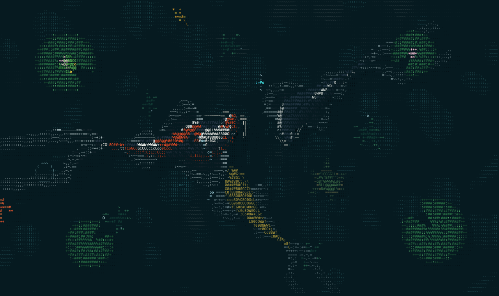

# ASCII Koi Pond — Windows (Live Wallpaper + Screen Saver)

A native, single-file Windows app (`ASCIIKoiPond.exe`) written in C# + Win32 GDI that runs the full top-down ASCII Koi Pond ecosystem as a **Live Wallpaper behind your desktop icons**, an **interactive preview window**, or a **Windows Screen Saver (`.scr`)**.



## Quick Start (No Installation Needed)

1. Download **`ASCIIKoiPond.exe`** from the **[v1.0-windows Release](https://github.com/Colcolat/ASCIIKoiSaver/releases/tag/v1.0-windows)**.
2. Double-click **`ASCIIKoiPond.exe`** (no .NET runtime required — fully self-contained).
3. Your desktop immediately becomes the animated ASCII Koi Pond (behind your icons!), with a **Koi icon in the System Tray** (bottom-right taskbar).

### System Tray Controls (Right-Click)
- **Live Wallpaper**: Toggle animated desktop wallpaper On/Off (restores your normal wallpaper cleanly on Exit)
- **Open Interactive Window**: Click anywhere in the water to create ripples and attract the Koi
- **Launch Screen Saver**: Instant fullscreen preview
- **Options…**: Configure **Time of Day** (Auto / Day / Sunset / Night), **Season** (Auto / Spring / Summer / Autumn / Winter), **Koi Count** (2–5), **Submerged Stone Clock**, **Gentle Rain**, and **Pure ASCII (monochrome)** mode
- **Create Screen Saver (`.scr`) Copy**: Creates `ASCIIKoiPond.scr` next to the `.exe` — right-click it and choose **Install** to set it as your Windows Screen Saver

## Build from Source

Requires [.NET 10 SDK](https://dotnet.microsoft.com/download) (builds on Windows or cross-compiles from macOS/Linux):

```bash
cd windows/ASCIIKoiPond
dotnet publish -c Release -r win-x64 --self-contained true -o ../dist
```
